# KTKLegacy

Неофициальный клиент электронного журнала колледжа [`ktk.education-system.ru`](https://ktk.education-system.ru)
для старых телефонов, которые современный сайт уже не открывают.

Расписание на неделю, оценки, задания, вебинары и файлы заданий — на iPhone с iOS 6,
Android 4.1 и Nokia на Symbian.

| | Платформа | Язык | Минимальная версия | Папка |
|---|---|---|---|---|
| 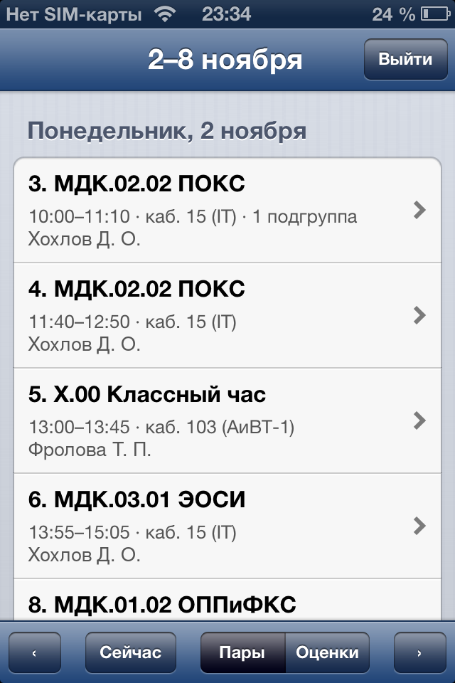 | **iOS** | Objective-C | iOS 6, armv7 (iPhone 3GS и новее), джейлбрейк | [`ktk-ios`](ktk-ios) |
| 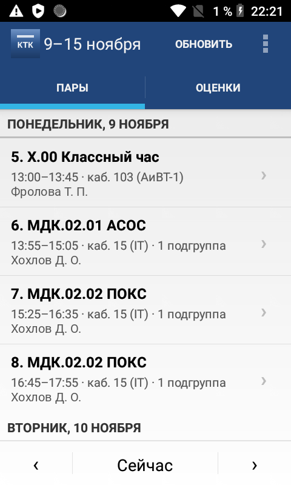 | **Android** | Java | Android 4.1 (API 16) | [`ktk-android`](ktk-android) |
| 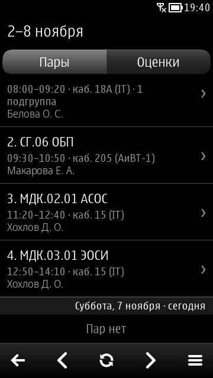 | **Symbian** | C++98, Qt 4.7, QML | Symbian^3 / Anna / Belle (проверено на Nokia N8, Belle FP2) | [`ktk-symbian`](ktk-symbian) |

## Скачать

Готовые сборки (`.deb` / `.ipa`, `.apk`, `.sis`) лежат в [Releases](../../releases).

## Зачем это нужно

Сайт работает только по TLS 1.2+ с ECDSA-сертификатом Let's Encrypt (цепочка до ISRG Root X1/X2).
Старые системы так не умеют: в iOS 6 нет нужных корней, в Android 4.1–4.4 TLS 1.2 выключен,
а Symbian знает только TLS 1.0. Поэтому каждый клиент везёт свой TLS:

| Платформа | TLS |
|---|---|
| iOS | libcurl 8.0.1 + OpenSSL 3.4.6, корни Mozilla |
| Android | системный стек, TLS 1.2 включается вручную, корни ISRG вшиты в APK |
| Symbian | BearSSL поверх `QTcpSocket`, корни ISRG вшиты в приложение |

Протокол у всех трёх общий: серверные функции TanStack Start в формате seroval. Он перенесён из бота
[kurumihere/ktk-schedule](https://github.com/kurumihere/ktk-schedule).

## Сборка

Каждый клиент собирается отдельно, подробности в его README:

- **iOS** — `./build-mac.sh` на Mac с Xcode 4.5–4.6 или `make package` через theos на Linux. [ktk-ios/README.md](ktk-ios/README.md)
- **Android** — `./build.sh`: JDK 17+ и Android SDK (build-tools, platform 16), без Gradle. [ktk-android/README.md](ktk-android/README.md)
- **Symbian** — `build-symbian.cmd` на Windows с Qt SDK 1.2.1. Ядро можно проверить на Linux с Qt 5. [ktk-symbian/README.md](ktk-symbian/README.md), где взять SDK — [ktk-symbian/QT-SDK.txt](ktk-symbian/QT-SDK.txt)

## Скриншоты

iOS 6

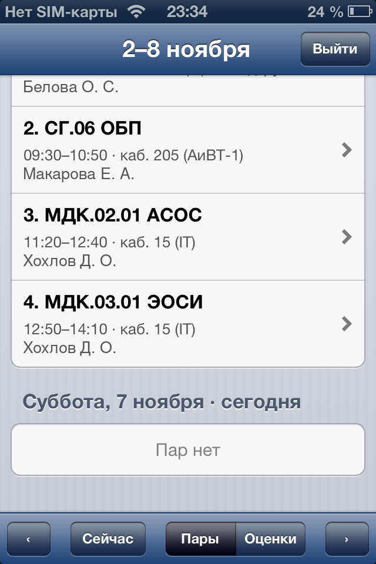 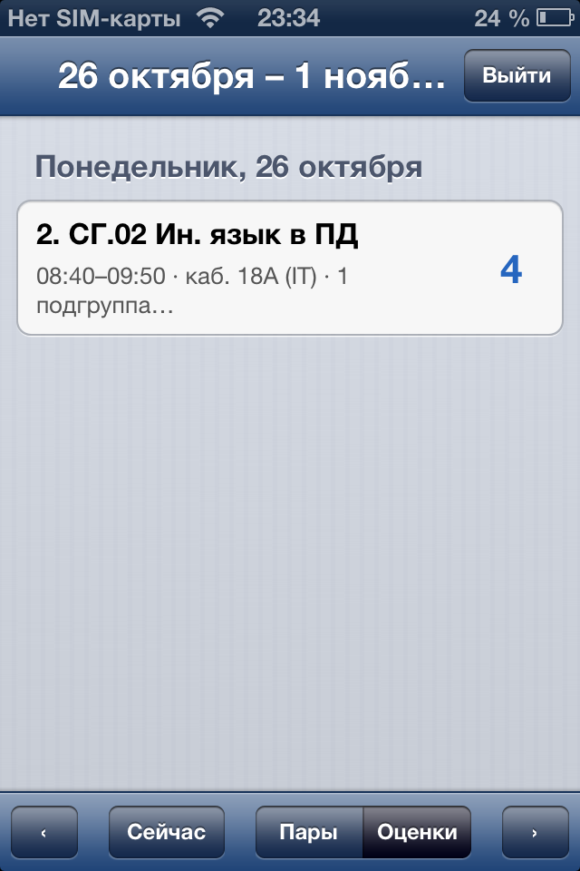 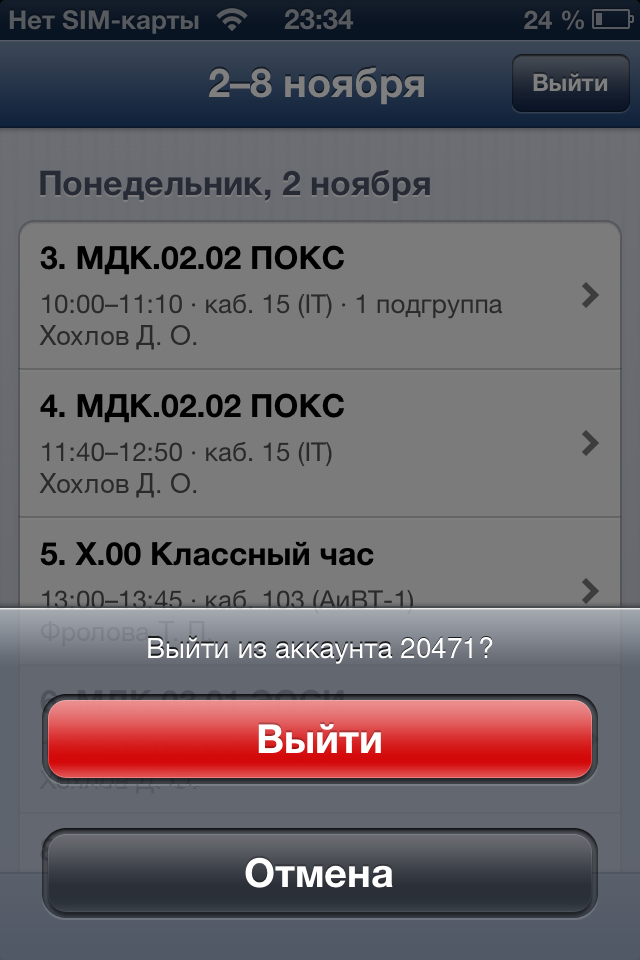 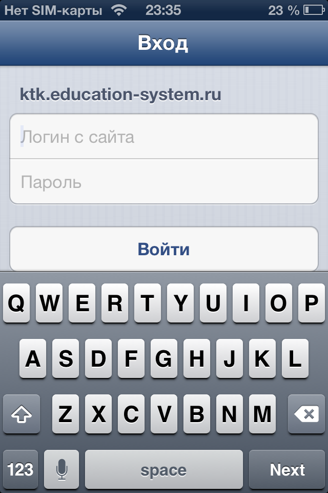

Android 4.1+

 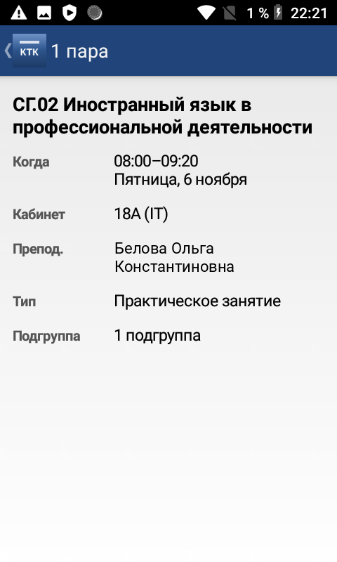 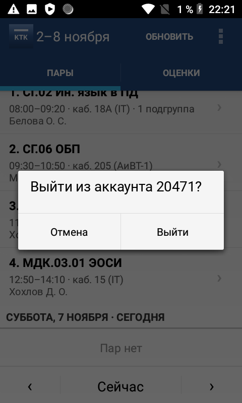 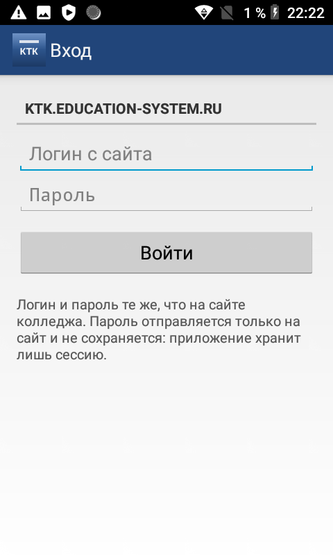

Symbian Belle

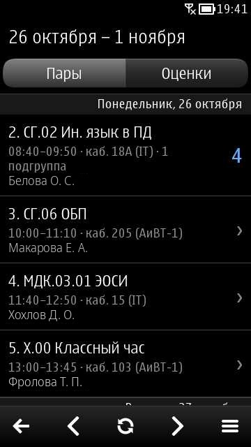 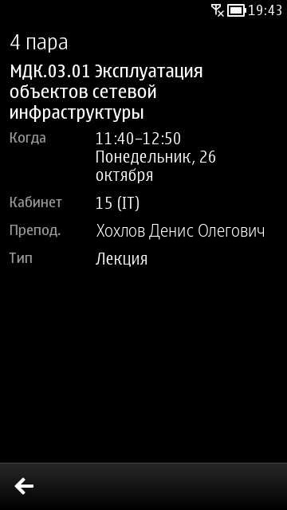 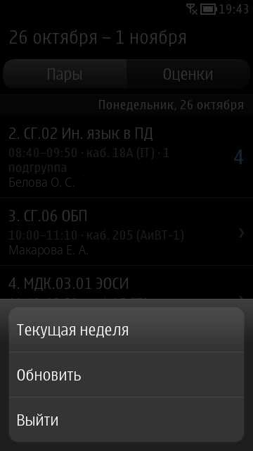 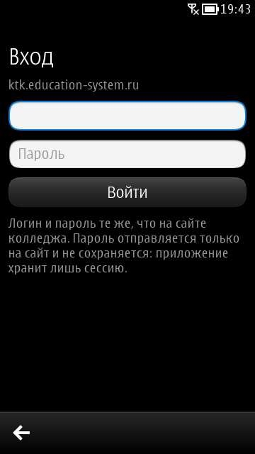

Имена преподавателей и логин на скриншотах вымышленные.

## Безопасность

Пароль отправляется только на сайт колледжа и нигде не сохраняется: приложения хранят лишь cookie сессии.
При выходе удаляются сессия, кэш недель и скачанные файлы.

## Лицензия

Код проекта распространяется под лицензией [MIT](LICENSE). Сторонние компоненты (BearSSL, libcurl, OpenSSL,
корни Mozilla, протокол из ktk-schedule) — под своими лицензиями, см. [THIRD_PARTY_NOTICES.md](THIRD_PARTY_NOTICES.md).

Проект не связан с колледжем и разработчиками `education-system.ru`.
